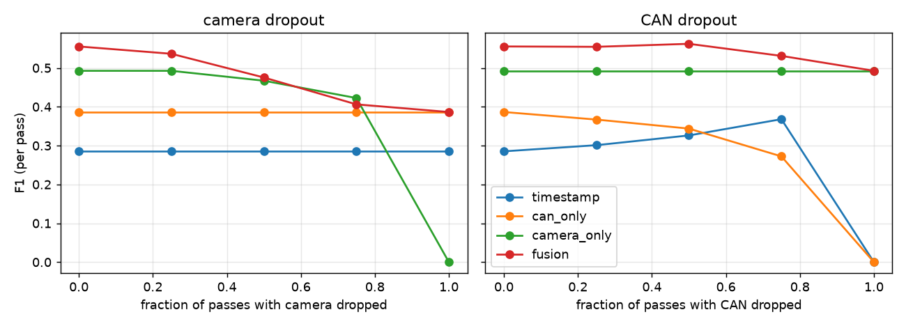

# Fleet Memory

A shared, decaying **site-condition map** built from many vehicles' observations, with
**evidence-grounded warnings**. When one vehicle sees something that changes a stretch of road
(reduced traction, an obstruction), the vehicles that come after it can be warned, with the
evidence cited, or told nothing if the evidence is thin.

Fleet Memory replays multi-vehicle drives as a simulated fleet, keeps a per-road-segment condition
state with confidence and exponential decay, and compares four ways of maintaining it:

| method | what it uses |
|---|---|
| `timestamp` | raw single-threshold CAN trigger, flag held for a fixed time window |
| `can_only` | learned evidence model on CAN signals (slip ratio, deceleration) |
| `camera_only` | learned evidence model on camera embeddings vs. each segment's normal look |
| `fusion` | both, with graceful fallback to one modality or none when a sensor is missing |

Measured: detection quality (precision, recall, F1), false-alarm rate, event recall, detection
delay, **warning lead time**, and **robustness when a sensor is dropped**. A recommender then turns
a warning into actions, citing the vehicles, signals and camera frames behind it, and abstains
when evidence is insufficient, stale or conflicting.

## Important: what is and is not real here

All results in this repository come from a **synthetic fleet simulator** (`src/fleetmem/sim.py`)
with injected condition changes and known ground truth. It exists to develop and stress-test the
method under controlled conditions. **It is not real vehicle data, and none of these numbers are
real-world performance.** The simulator is also built so that each event type is easy for one
modality and hard for the other, so "fusion helps" is partly a property of the simulator, not a
discovery. Running on real multi-drive data (e.g. a public driving dataset) is the next step; the
`Observation` type is the interface for it (see `docs/BLUEPRINT.md`). That adapter is **not yet
implemented**.

## Results (5 held-out seeds, synthetic)

Full tables: [`results/results.md`](results/results.md). Raw: [`results/results.json`](results/results.json).

| method | precision | recall | F1 | false-alarm rate | event recall | detection delay (s) | lead time (s) |
|---|---|---|---|---|---|---|---|
| timestamp | 0.196 | 0.568 | 0.285 | 0.221 | 0.743 | 71 | 825 |
| can_only | 0.626 | 0.284 | 0.386 | 0.015 | 0.429 | 555 | 612 |
| camera_only | 0.507 | 0.481 | 0.493 | 0.041 | 0.600 | 270 | 698 |
| fusion | 0.654 | 0.490 | 0.555 | 0.022 | 0.871 | 788 | 523 |



What the numbers say, including the unflattering parts:

- Fusion has the best F1 and event recall, and it degrades gracefully: with the camera fully
  dropped it falls back to CAN-only performance (0.386), with CAN fully dropped to camera-only
  (0.493). Single-modality methods go to zero when their own sensor is gone.
- Fusion is **slowest to detect** (788 s median delay vs. 71 s for the timestamp baseline). It
  needs agreeing evidence from at least two passes before warning, which is what keeps its
  false-alarm rate about 10x lower than the timestamp baseline's (0.022 vs. 0.221). Whether that
  trade is right depends on the cost of a false alarm; the threshold is configurable.
- Recall is modest for every method. The first vehicle through an event has nobody to warn it,
  15% of vehicles in an event do not show the effect, and the warning threshold needs two
  observations.
- The recommender abstains on only about 2% of warned passes here, and the precision of the
  recommendations it emits (0.647) is the same as the warnings' (0.654). So at these settings,
  abstention does not make the output more selective; it only guards against degenerate cases
  (covered in unit tests). Citation verification is 1.0 by construction for the template renderer.
- Dropping CAN increases the timestamp baseline's F1 at 0.5 to 0.75 dropout, because it removes
  false triggers along with true ones: a reminder that F1 alone is not the whole story.

## How it works

```
Observation (vehicle, time, segment, CAN?, camera embedding?, frame ref?)
   -> Detector: log-likelihood ratio that the segment's condition changed (None if no signal)
   -> DecayMemory: per-segment log-odds, evidence halves every `half_life_s`, with confidence n_eff
   -> warn if p >= p_threshold and n_eff >= min_n_eff   (queried BEFORE the pass's own data)
   -> Recommender: cites ledger records; abstains if < min_vehicles, stale, or conflicting
```

Design choices worth knowing:

- **No look-ahead.** The memory is queried before a pass's own observation is folded in, so a
  vehicle is only ever warned by earlier vehicles.
- **Missing sensors are `None`, never imputed.** A detector with no usable signal contributes no
  evidence.
- **Idempotent updates.** Re-delivering an observation (same `obs_id`) changes nothing.
- **Train/test separation.** Detectors train on one simulated run and are evaluated on runs with
  different seeds (new vehicle biases, event placements, noise). Thresholds were fixed up front
  and not tuned on the test seeds.
- **Everything tunable is in [`configs/default.yaml`](configs/default.yaml)**; the loader rejects
  unknown or missing keys.

## Quick start

```bash
python -m venv .venv
.venv/Scripts/activate            # Windows; use `source .venv/bin/activate` elsewhere
pip install -e ".[dev,plots]"
pytest                            # 53 tests
fleetmem run --config configs/default.yaml --out results   # about 10 s
```

## Layout

| path | purpose |
|---|---|
| `src/fleetmem/sim.py` | synthetic fleet with injected condition changes (dev/eval only) |
| `src/fleetmem/detectors.py` | timestamp, CAN-only, camera-only and fusion evidence models |
| `src/fleetmem/memory.py` | decaying per-segment state; timestamp baseline memory |
| `src/fleetmem/replay.py` | online time-ordered replay, no look-ahead |
| `src/fleetmem/recommend.py` | evidence ledger, cited recommendations, abstention, `verify` |
| `src/fleetmem/metrics.py` | precision/recall/F1, false alarms, delay, lead time |
| `src/fleetmem/experiment.py` | train/test protocol and sensor-dropout sweep |
| `docs/BLUEPRINT.md` | full technical specification, ADRs, roadmap, open decisions |

## Roadmap

1. Real-data adapter: convert a public multi-drive dataset to `Observation`s and review-labelled
   condition changes (open decision: which dataset, see the blueprint).
2. Replace the synthetic camera embedding with a real vision encoder's embedding.
3. LLM phrasing of recommendations behind the existing `verify` gate, with a faithfulness test.
4. Learn the decay half-life and thresholds on validation data instead of fixing them.
