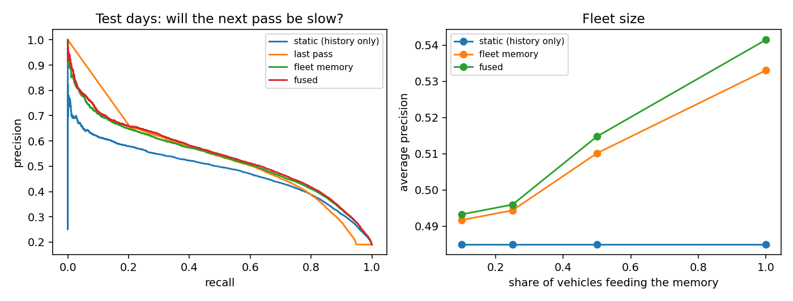

# Fleet Memory

A shared, decaying memory of what recent vehicles experienced on each road cell. When one car slows down, the next cars can be warned. Tested on real data from 384 cars.

## What I did
- Used the Vehicle Energy Dataset: OBD-II logs of 384 cars around Ann Arbor, Michigan, November 2017 to November 2018. I turned 22 million records into 1.1 million passes through 2,429 road cells (165 m squares seen from one of four headings).
- Defined the task: when a vehicle is about to enter a road cell, will its pass be **slow**, meaning mean speed below 60% of the cell's free-flow speed?
- Replayed the year in time order. A pass becomes visible only when it ends, and a vehicle asks before its own pass is added (tested).
- Compared four predictors:

| predictor | idea |
|---|---|
| static | probability of a slow pass per cell, weekday or weekend and 3-hour block, from the first 150 days |
| last pass | was the most recent visible pass of the cell slow (within 30 minutes) |
| fleet memory | decayed count of slow passes (half-life 10 minutes), shrunk toward the static prior |
| fused | logistic regression on the above plus confidence, fitted on days 150 to 240 |

## Results
Test: days 240 to 365; intervals resample whole days.

| predictor | average precision | AUROC | Brier |
|---|---|---|---|
| static | 0.485 (0.478 to 0.491) | 0.816 | 0.122 |
| last pass | 0.505 (0.498 to 0.512) | 0.802 | 0.129 |
| fleet memory | 0.533 (0.525 to 0.541) | 0.834 | 0.118 |
| **fused** | **0.541 (0.533 to 0.550)** | **0.837** | **0.115** |

- Fused beats static by **+0.057** average precision (+0.051 to +0.061).
- The gain is largest where history cannot help. On "unexpected" passes (static prior below 10%, 45% of queries) average precision rises from 0.071 to 0.228.
- Feeding the memory from only 10% of the cars gives 0.493; from 50% of the cars, 0.515.
- At the loosest threshold that keeps 50% precision on validation, history warns on 202 per 1000 passes and catches 52% of slow ones; the fused model warns on 249 and catches 65%.



Full tables: [results/results.md](results/results.md).

## How it was built

```
download VED -> passes (22 M records to 1.1 M passes) -> time-ordered replay
             -> static / last pass / fleet memory / fused -> evaluate -> report
```

```bash
pip install -e .[dev]
fleetmem download      # VED, 176 MB
fleetmem passes        # about a minute
fleetmem run           # replay, evaluate, write results/
pytest
```

Settings are in `configs/default.yaml`. 11 tests: memory decay, no look-ahead in the replay, labels and time buckets.

## Tech stack
Python, Polars, pandas, NumPy, scikit-learn, pyarrow, matplotlib, pytest.

## Data
Oh, Leblanc, Peng, *Vehicle Energy Dataset (VED)*, IEEE T-ITS 2022 (Apache-2.0), <https://github.com/gsoh/VED>. The raw data is not redistributed here. Code: MIT.
