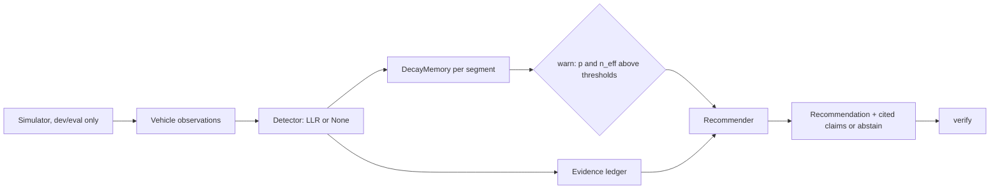

# Fleet Memory: technical blueprint

Status: v0.1 implemented against simulated data. Real-data phases are specified, not built.

**Scope note.** This is a research and portfolio repository, not a deployed service. Per the
blueprint method, sections that do not apply are collapsed with a reason: no authn/authz, roles,
REST API, frontend, queues, or deployment topology (single-process library + CLI; no users, no
network surface). The seven design rules still apply and are reflected below.

## 1. Executive summary

**Problem.** A condition seen by one vehicle (low traction, an obstruction) affects vehicles that
reach the same place later. A fleet needs a shared, time-aware model of site conditions that can
warn followers and explain why.

**Approach.** Each vehicle pass over a road segment yields an `Observation` (CAN signals, camera
embedding, frame reference). A detector turns it into a log-likelihood ratio; a per-segment memory
accumulates these with exponential decay and a confidence count; a warning fires when posterior and
confidence cross configured thresholds; a recommender explains the warning from a ledger of cited
evidence or abstains.

**Key challenges.** Evidence is sparse and noisy; sensors drop out; conditions expire; the first
vehicle cannot be warned; warnings must be explainable and verifiable; evaluation must not leak the
future or the labels.

## 2. Requirements

| id | requirement | priority |
|---|---|---|
| F1 | Maintain a per-segment condition state with confidence from multi-vehicle observations | must |
| F2 | State decays toward a prior as evidence ages | must |
| F3 | Compare timestamp-only, CAN-only, camera-only and multimodal fusion methods | must |
| F4 | Replay time-ordered with no look-ahead and no self-confirmation | must |
| F5 | Report precision, recall, F1, false-alarm rate, event recall, detection delay, lead time | must |
| F6 | Sweep sensor dropout per modality and report degradation | must |
| F7 | Recommendations cite ledger evidence; abstain on thin, stale or conflicting evidence | must |
| F8 | Verify every claim against the ledger (`verify`) | must |
| F9 | Real-data adapters (see section 12) | should |
| F10 | LLM phrasing of recommendations behind `verify` | could |
| N1 | Deterministic given seeds and config | must |
| N2 | All tunables in YAML; loader rejects unknown or missing keys | must |
| N3 | Idempotent observation updates (duplicate `obs_id` is a no-op) | must |
| N4 | Full replay of the default experiment in well under a minute on a laptop | should |
| N5 | Missing sensors are represented as `None`, never imputed | must |

## 3. Actors

System actors only: **Fleet vehicle** (producer of observations), **Memory service** (library),
**Evaluator** (experiment runner), **Operator** (future consumer of recommendations).

## 4. Architecture

A single-process Python library (modular monolith). Rejected alternatives: microservices or a
stream processor (no throughput or deployment need at this stage); a database (state fits in
memory, and the ledger is bounded per segment). The same `Detector` / `Memory` / `Recommender`
interfaces would sit behind a service when real fleets exist.

## 5. Components

| component | responsibility | must NOT |
|---|---|---|
| `schema` | `Observation`, `Event`, `SimResult` types | contain logic |
| `config` | strict YAML load and validation | provide silent defaults |
| `sim` | simulated fleet with injected events and ground truth | be used to report real-world performance |
| `detectors` | observation to LLR (or `None`); per-modality attribution | see ground-truth labels at inference |
| `memory` | decaying state, confidence, idempotent update | know about sensors or models |
| `replay` | time-ordered online evaluation | let a pass see its own data |
| `recommend` | ledger, claims, abstention, `verify` | emit a claim without cited evidence |
| `metrics` | pass and event metrics, aggregation | invent a value when undefined (returns `None`) |
| `experiment`, `report`, `cli` | train/test protocol, dropout sweep, outputs | tune on test seeds |

## 6. Data

**Observation**: `obs_id` (str, unique, idempotency key), `vehicle_id` (str), `t` (float seconds),
`segment` (int), `can` (`{slip_ratio, decel_mps2}` or `None`), `cam` (float vector or `None`),
`frame_ref` (str or `None`, present only with `cam`).

**EvidenceRecord**: `obs_id`, `vehicle_id`, `t`, `segment`, `llr`, `can_llr?`, `cam_llr?`,
`slip_ratio?`, `decel_mps2?`, `frame_ref?`. Bounded per segment (`ledger_max_per_segment`, oldest
dropped). **SegmentState**: `p`, `n_eff`. Source of truth for ground truth: `Event` list (sim) or
reviewed condition changes (real data).

**Memory update.** Per segment keep deviation `d` (log-odds above the prior), count `n`, last time
`t0`. Query at `t`: `f = 0.5^((t - t0)/half_life)`, `p = sigmoid(logit(prior) + d f)`,
`n_eff = n f`. Update with LLR `l`: `d <- d f + clip(l, -c, c)`, `n <- n f + 1`. Late
(out-of-order) updates decay by 0 and never move `t0` backwards.

## 7. Data flow and state

Replay per pass: query memory (warn decision made with only earlier data) -> record pass ->
update memory and ledger with the pass's own evidence. A segment is "warned" iff
`p >= p_threshold and n_eff >= min_n_eff`; it leaves that state by decay or by contradicting
evidence. `warn_since` is the first update at which the state crossed the threshold (used for
lead time).

## 8. Algorithms

- **Evidence model (`_Model`)**: L2-regularised logistic regression via IRLS on standardised
  features; LLR = decision value minus the training prior's logit (so it is relative to the
  training prevalence, and the memory's configured prior sets the operating prior).
- **CAN features**: slip ratio, peak deceleration. **Camera feature**: distance of the embedding
  to the segment's mean embedding over event-free passes (a "normal look" reference).
- **Fusion**: one model per modality-availability set (both / CAN / camera); with none, `None`.
- **Timestamp baseline**: raw threshold trigger on CAN, flag held for `hold_s`; no learning,
  no confidence, no decay.
- **Recommender**: windowed ledger records with `llr > 0`; abstain reasons in order:
  `below_threshold`, `insufficient_vehicles`, `stale_evidence`, `conflicting_evidence`
  (negative LLR mass share above `conflict_ratio`). Cause = CAN vs camera contribution with a
  `dominance` ratio; actions come from `recommend.policy` in config.

## 9. AI/ML and LLM

ML is used only where a learned boundary is needed (evidence models). The decision to warn is
deterministic (thresholds on a probabilistic state). The recommender is deterministic and
template-based today. **LLM phrasing is not implemented.** Planned design: an LLM may only rewrite
text for claims already built from ledger records; its output must pass `verify` (claim params
recomputed from cited records) and a numeric-consistency check, else fall back to the template.
Raw LLM output is never trusted or used to make the warn/abstain decision.

## 10. Failure and edge cases

| case | behaviour |
|---|---|
| sensor missing | `None`; detector contributes nothing; fusion degrades to one modality |
| duplicate observation | ignored (same `obs_id`) |
| out-of-order observation | decay by 0; state time never goes backwards |
| unsorted replay input | `ValueError` |
| no event-free or no event training passes | `ValueError` at fit |
| segment never seen | prior probability, `n_eff = 0`, no warning |
| unknown/missing config key | `ConfigError` at load |
| ledger overflow | oldest records dropped (bounded memory) |
| conflicting evidence | abstain |

## 11. Testing and evaluation

53 unit and integration tests cover: config strictness, simulator determinism and label
consistency, memory decay/clipping/idempotency, detector behaviour under missing modalities,
no-self-confirmation in replay, metric definitions against hand-computed values, every abstention
reason, tampered/unknown/empty claims failing `verify`, and an end-to-end ordering sanity check.

**Protocol.** Train detectors on one simulated run (`train_seed`); evaluate on separate seeds
(different vehicle biases, event placement, noise). Report mean and std over seeds. Thresholds
are fixed in config before evaluation. Sensor dropout is applied to test data only, independently
per pass. **Limitations:** simulator-only; fusion's advantage is partly designed in (each event type
is easy for one modality); single logistic models; no confidence intervals beyond seed std.

## 12. Real-data adapters (specified, not implemented)

An adapter converts a dataset's drives into `Observation`s plus reviewed condition-change labels:
map-match each pass to a `segment`; take CAN-like signals (speed-derived deceleration, wheel-slip
proxy) from vehicle data; take camera embeddings from a frozen vision encoder over a frame
sampled at the segment; set `frame_ref` to a stable frame identifier. Candidates: Zenseact Open
Dataset (Swedish roads, registration and licence terms apply), nuScenes, Argoverse 2, comma2k19.
Key difficulty: repeated passes over the same road with *labelled* condition changes are rare in
public data, so labels may need weak or manual construction.

## 13. Repository, local development, CI

See the README for layout and commands. CI (`.github/workflows/ci.yml`) runs `ruff` and `pytest`
on Python 3.10 and 3.12. Dependencies: `numpy`, `pyyaml` (runtime); `matplotlib` (optional
plots); `pytest`, `ruff` (dev). No scikit-learn: the logistic model is ~30 lines and avoids a heavy
dependency.

## 14. Risks

| risk | consequence | mitigation |
|---|---|---|
| Simulator results mistaken for real performance | misleading claims | README and results state it; adapter work is the roadmap's first item |
| Simulator favours fusion by construction | overstated benefit | documented; real-data run is the actual test |
| Decay half-life and thresholds fixed by hand | suboptimal trade-offs | configurable; learn on validation data (roadmap) |
| Warning delay (fusion) too long for fast-changing conditions | late warnings | tune thresholds per cost of false alarm; report delay and lead time |
| Weak labels on real data | noisy evaluation | state label quality; report uncertainty |

## 15. Architectural decisions

| decision | alternatives | chosen | reason / consequence |
|---|---|---|---|
| State representation | sliding window count; Kalman/HMM; log-odds with decay | log-odds with exponential decay | simple, explainable, evidence adds in LLR; assumes conditional independence of observations |
| Baseline | none; threshold only | timestamp hold-window baseline | gives the JD's timestamp-based comparison a concrete, fair reference |
| Evidence model | deep network; gradient boosting; logistic | logistic (IRLS) | few features, interpretable, no heavy dependency |
| Missing sensor | imputation; zero-fill; availability-set models | availability-set models, `None` | no fabricated inputs (rule 3) |
| Recommender | free-form LLM; templates + verify | templates + `verify`, LLM later | claims are checkable; LLM can only rephrase |
| Evaluation leak control | random split of passes; seed split | seed split, query-before-update | avoids look-ahead and self-confirmation |
| Persistence | database; in-memory | in-memory, bounded ledger | no multi-process or durability need yet |

## 16. REQUIRES USER DECISION

1. **Real dataset for phase 2.** Zenseact Open Dataset needs registration and licence acceptance;
   others differ in repeated-pass coverage. Which one to target, and who creates the account.
2. **LLM backend for phrasing** (hosted API vs local model) and whether API cost is acceptable.
3. **Repository visibility.** Currently intended public as a portfolio piece.

## 17. Roadmap

| phase | objective | acceptance |
|---|---|---|
| 1 (done) | simulated fleet, four methods, dropout sweep, cited recommender, tests, CI | `pytest` green; `fleetmem run` reproduces `results/` |
| 2 | real-data adapter and labels | one dataset converted; same experiment runs; limitations documented |
| 3 | real camera embeddings (frozen encoder) | camera feature from images, evaluated on phase 2 data |
| 4 | LLM phrasing behind `verify` | faithfulness test: share of claims verifiable; abstention test still passes |
| 5 | learn half-life and thresholds | chosen on validation seeds/drives, reported on held-out |

## 18. Definition of done (phase 1)

- [x] Requirements F1 to F8 and N1 to N5 implemented
- [x] Nothing important hardcoded (everything tunable in `configs/default.yaml`)
- [x] No fake functionality: simulator labelled as such; LLM phrasing and real-data adapters stated as not implemented
- [x] Tests pass; results reproducible from config and seeds
- [x] README states limitations and unflattering results
